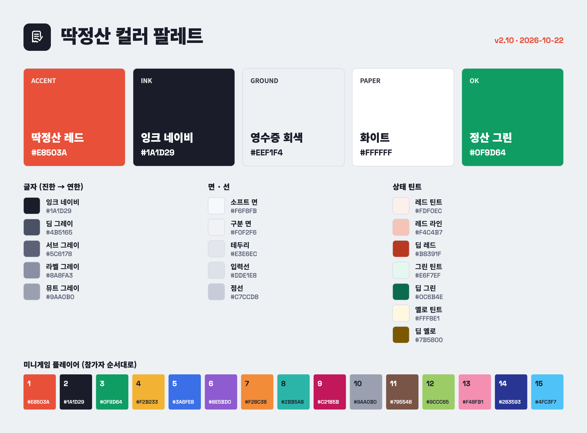

# 딱정산 컬러 팔레트

> v2.10 · 2026-10-22 기준 · 모든 값은 화면용 sRGB. 원본은 앱 코드(`src/shared/styles.js` · `src/games/palette.js`)이고,
> 이 문서는 `admin/brand/build-palette.mjs` 가 만든다 — 색을 바꾸면 스크립트의 데이터를 고치고 다시 실행한다.

영수증 종이 같은 밝은 회색 바탕에 남색 글씨, 그리고 도장처럼 찍히는 빨강 하나가 딱정산의 얼굴이다.

## 1. 코어 컬러

| 이름 | 영문 | HEX | RGB | 쓰임 |
|---|---|---|---|---|
| **딱정산 레드** | Ddak Red | `#E8503A` | 232, 80, 58 | 강조 · 주 버튼 · 당첨 도장 · 경고 |
| **잉크 네이비** | Ink Navy | `#1A1D29` | 26, 29, 41 | 기본 글씨 · 로고 · 앱 아이콘 바탕 |
| **영수증 회색** | Receipt Gray | `#EEF1F4` | 238, 241, 244 | 페이지 바탕 · 브라우저 테마색 |
| **화이트** | Paper White | `#FFFFFF` | 255, 255, 255 | 영수증 카드 · 반전 글씨 |
| **정산 그린** | Settle Green | `#0F9D64` | 15, 157, 100 | 완료 · 받을 돈 · 성공 |

- 앱 아이콘 · 로고: 잉크 네이비 바탕 + 흰 선. 브라우저 테마색과 앱 배경: 영수증 회색.
- 빨강은 "정산 계산하기" 버튼, "당첨" 도장처럼 **한 화면에 하나**만 쓰는 강조색.

## 2. 쓰는 비율 (앱 화면 기준, 대략)

| 비율 | 색 |
|---:|---|
| 45% | 영수증 회색 — 바탕 (`#EEF1F4`) |
| 35% | 화이트 — 카드 · 영수증 종이 (`#FFFFFF`) |
| 12% | 잉크 네이비 — 글씨 · 로고 (`#1A1D29`) |
| 6% | 딱정산 레드 — 버튼 · 도장 (`#E8503A`) |
| 2% | 정산 그린 — 완료 · 받을 돈 (`#0F9D64`) |

빨강 면적이 10%를 넘으면 경고 화면처럼 보이기 시작한다.

## 3. 글자 · 면 · 선 · 상태

### 글자 (진한 → 연한)

| 이름 | HEX | 쓰임 |
|---|---|---|
| 잉크 네이비 | `#1A1D29` | 제목 · 본문 |
| 딤 그레이 | `#4B5165` | 설명 문단 |
| 서브 그레이 | `#5C6178` | 보조 설명 |
| 라벨 그레이 | `#8A8FA3` | 섹션 라벨 · 단위 |
| 뮤트 그레이 | `#9AA0B0` | 비활성 · 힌트 (작은 글씨엔 비추천) |

### 면 · 선

| 이름 | HEX | 쓰임 |
|---|---|---|
| 소프트 면 | `#F6F8FB` | 칩 · 게임 카드 바탕 |
| 구분 면 | `#F0F2F6` | 얇은 구분선 |
| 테두리 | `#E3E6EC` | 카드 · 표 테두리 |
| 입력선 | `#DDE1E8` | 입력칸 밑줄 |
| 점선 | `#C7CCD8` | 점선 버튼 · 잠긴 카드 |

### 상태 틴트

| 이름 | HEX | 쓰임 |
|---|---|---|
| 레드 틴트 | `#FDF0EC` | 경고 · 당첨 줄 바탕 |
| 레드 라인 | `#F4C4B7` | 경고 테두리 |
| 딥 레드 | `#B8391F` | 경고 글씨 · 버튼 그림자 |
| 그린 틴트 | `#E6F7EF` | 완료 바탕 |
| 딥 그린 | `#0C6B4E` | 완료 글씨 |
| 옐로 틴트 | `#FFF8E1` | "화면 가리기" 안내 바탕 |
| 딥 옐로 | `#7B5800` | 안내 글씨 |

상태 조합: 경고 = 바탕 `#FDF0EC` + 테두리 `#F4C4B7` + 글씨 `#B8391F` · 완료 = 바탕 `#E6F7EF` + 테두리 `#C8E6C9` + 글씨 `#0C6B4E` · 안내 = 바탕 `#FFF8E1` + 테두리 `#FFE082` + 글씨 `#7B5800`

## 4. 미니게임 플레이어 컬러

참가자 순서대로 돌아가며 쓰는 보조 팔레트. 게임 · 이벤트 홍보에만 쓰고, 정산 기능 홍보에는 코어 색만 쓴다.

| 순서 | 바탕 | 이름 글씨 |
|---:|---|---|
| 1 | `#E8503A` | `#FFFFFF` |
| 2 | `#1A1D29` | `#FFFFFF` |
| 3 | `#0F9D64` | `#FFFFFF` |
| 4 | `#F2B233` | `#1A1D29` |
| 5 | `#3A6FE8` | `#FFFFFF` |
| 6 | `#8E5BD0` | `#FFFFFF` |
| 7 | `#F28C38` | `#1A1D29` |
| 8 | `#2BB5A8` | `#1A1D29` |
| 9 | `#C2185B` | `#FFFFFF` |
| 10 | `#9AA0B0` | `#1A1D29` |
| 11 | `#795548` | `#FFFFFF` |
| 12 | `#9CCC65` | `#1A1D29` |
| 13 | `#F48FB1` | `#1A1D29` |
| 14 | `#283593` | `#FFFFFF` |
| 15 | `#4FC3F7` | `#1A1D29` |

## 5. 글자 대비 (WCAG AA)

| 글씨 / 바탕 | 값 | 대비 | 판정 |
|---|---|---:|---|
| 본문 글씨 / 바탕 | `#1A1D29` / `#EEF1F4` | 14.80 : 1 | 모든 글씨 |
| 본문 글씨 / 카드 | `#1A1D29` / `#FFFFFF` | 16.78 : 1 | 모든 글씨 |
| 흰 글씨 / 네이비 | `#FFFFFF` / `#1A1D29` | 16.78 : 1 | 모든 글씨 |
| 설명 글씨 / 카드 | `#4B5165` / `#FFFFFF` | 7.88 : 1 | 모든 글씨 |
| 레드 글씨 / 네이비 | `#E8503A` / `#1A1D29` | 4.51 : 1 | 모든 글씨 |
| 버튼 글씨 / 레드 | `#FFFFFF` / `#E8503A` | 3.72 : 1 | 큰 글씨만 |
| 레드 글씨 / 카드 | `#E8503A` / `#FFFFFF` | 3.72 : 1 | 큰 글씨만 |
| 흰 글씨 / 그린 | `#FFFFFF` / `#0F9D64` | 3.48 : 1 | 큰 글씨만 |
| 경고 글씨 / 레드 틴트 | `#B8391F` / `#FDF0EC` | 5.17 : 1 | 모든 글씨 |
| 라벨 / 카드 | `#8A8FA3` / `#FFFFFF` | 3.21 : 1 | 큰 글씨만 |
| 뮤트 / 카드 | `#9AA0B0` / `#FFFFFF` | 2.62 : 1 | 글씨엔 쓰지 않기 |

"큰 글씨"는 24px 이상, 또는 굵게 19px 이상.

## 6. 글꼴

- **Pretendard** — 제목 · 본문 전부 (앱 기본 글꼴). 제목은 800~900 굵기, 자간 살짝 좁게.
- **Space Grotesk** — 금액 · 숫자 · 도장. 숫자 폭이 같은 tabular 숫자로.

## 7. 홍보물에 쓸 때

- **바탕은 영수증 회색이나 흰색.** 어두운 이미지가 필요하면 순검정 대신 잉크 네이비(#1A1D29)를 쓴다.
- **빨강은 한 군데만.** 핵심 문구 하나, 버튼 하나, 도장 하나처럼 시선이 갈 곳 한 곳에. 면적이 10%를 넘으면 경고 화면처럼 보인다.
- **초록은 "끝났다 · 받는다"에만.** 정산 완료, 받을 금액처럼 좋은 결과를 뜻할 때 쓴다.
- **모서리는 4~6px로 살짝만.** 앱의 카드 · 버튼은 영수증처럼 각진 편이다. 영수증 아래 지그재그 가장자리도 브랜드 요소다.
- **작은 글씨는 빨강 위에 올리지 않는다.** 흰 글씨 + 레드는 3.7 : 1이라 큰 글씨(24px 이상, 굵게 19px 이상)에만 쓴다.
- **인쇄할 때는 교정을 본다.** 모든 값은 화면용(sRGB)이다. 특히 레드는 인쇄 교정으로 한 번 확인한다.

## 8. 같은 팔레트, 다른 형식 (이 폴더)

| 파일 | 쓰는 곳 |
|---|---|
| `ddakjeongsan-palette.html` | 브라우저로 여는 안내 페이지 (색 코드 누르면 복사) |
| `ddakjeongsan-palette.pdf` | 인쇄 · 공유 |
| `ddakjeongsan-palette.md` | 이 문서 — 노션 · GitHub |
| `ddakjeongsan-palette.png` / `.svg` | 스와치 이미지 — 슬라이드 · Figma · Illustrator 에 그대로 |
| `ddakjeongsan.ase` | Adobe Photoshop · Illustrator · InDesign → 스와치 패널 → 스와치 불러오기 |
| `ddakjeongsan.gpl` | GIMP · Inkscape · Krita 팔레트 |
| `ddakjeongsan-tokens.json` | 디자인 토큰 (W3C DTCG) — Figma Tokens Studio · Style Dictionary |
| `ddakjeongsan-colors.css` | 웹 작업용 CSS 변수 |
